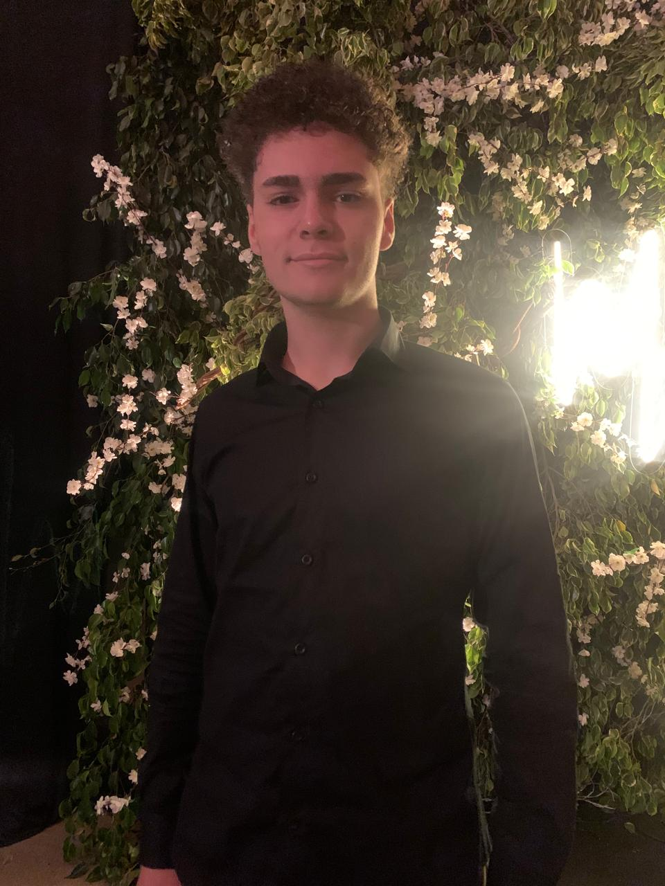
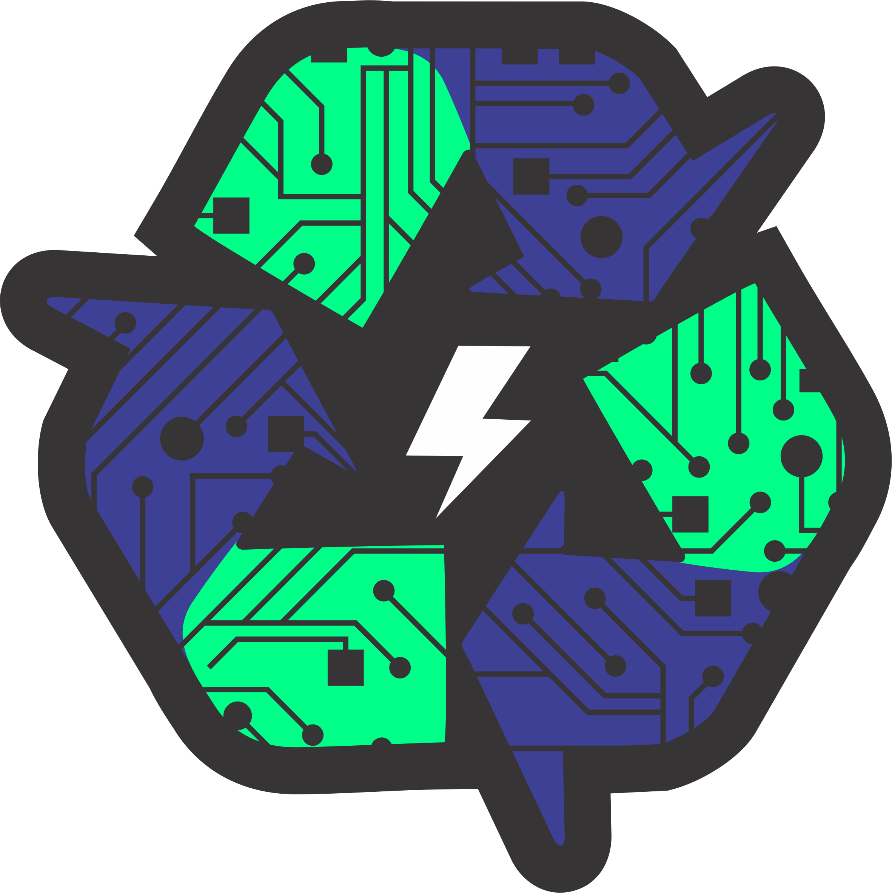

<h1 align="center">Diogo Rodrigues</h1>

<code>Information Technology Technician</code> · <code>Developer</code>

// Sobre mim

<table>
<tr>
<td width="70%">

<code>about_me.js</code>

Técnico em Informática formado pelo Colégio Cotemig, em Belo Horizonte - MG.

Interessado em desenvolvimento de software, tecnologia, banco de dados e infraestrutura de redes.

Busco constantemente aprimorar meus conhecimentos, desenvolver projetos e explorar novas tecnologias.

 

<strong>Formação:</strong> Técnico em Informática — Colégio Cotemig

<strong>Localização:</strong> Belo Horizonte, MG

<strong>Foco:</strong> Desenvolvimento de Software

<strong>Objetivo:</strong> Evolução profissional e aprendizado contínuo

</td>
<td width="30%" align="center">

</td>
</tr>
</table>

// Tecnologias & ferramentas
# Desenvolvimento Web

# Banco de dados & programação

# Ferramentas & infraestrutura

/* Conhecimentos */
Arquitetura e infraestrutura de redes
Modelagem e gerenciamento de bancos de dados
Lógica de programação
Desenvolvimento de aplicações web
Trabalho colaborativo e desenvolvimento de projetos
// Projetos em destaque

<table>
<tr>
<td width="70%">
<h3>Eletro Descartes</h3>

<code>Academic Project / Team Development</code>

Projeto acadêmico desenvolvido em equipe com o objetivo de conscientizar e apresentar soluções para o descarte incorreto de lixo eletrônico.

<strong>Stack:</strong> Laravel · PHP · MySQL

<a href="https://github.com/DiogoRodriguesActivity/EletroDescartes_1.0">
Acessar repositório →
</a>
</td>
<td width="30%" align="center">

</td>
</tr>
</table>

// Colaborações
javascript
const collaborations = {
    project: "Eletro Descartes",
    type: "Academic / Team Development",
    technologies: [
        "Laravel",
        "PHP",
        "MySQL"
    ],
    objective: "Desenvolver soluções em equipe"
};

Desenvolvimento colaborativo, compartilhamento de conhecimento e construção de soluções práticas.

// Ver meus repositórios

// GitHub Analytics

# Contribution Streak

# Activity Graph

// Contribution History

<picture data-importer="pacman">
  <source media="(prefers-color-scheme: dark)" srcset="https://raw.githubusercontent.com/DiogoRodriguesActivity/DiogoRodriguesActivity/pacman-output/pacman-contribution-graph-dark.svg?game=pacman">
  <source media="(prefers-color-scheme: light)" srcset="https://raw.githubusercontent.com/DiogoRodriguesActivity/DiogoRodriguesActivity/pacman-output/pacman-contribution-graph.svg?game=pacman">
  
</picture>

###

// Development Time
text
STATUS: CONSTANTLY LEARNING
FOCUS: SOFTWARE DEVELOPMENT
ACTIVITY: GITHUB CONTRIBUTIONS
GOAL: CONTINUOUS IMPROVEMENT

// Contact

<code>Diogo Rodrigues © 2026</code>

// Obrigado por visitar meu perfil. Explore meus projetos.

